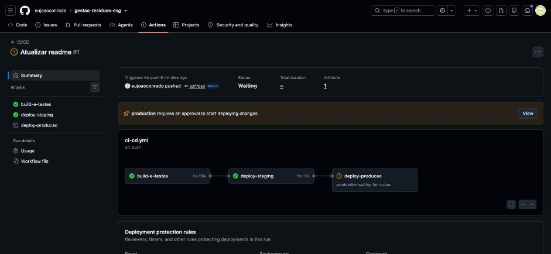
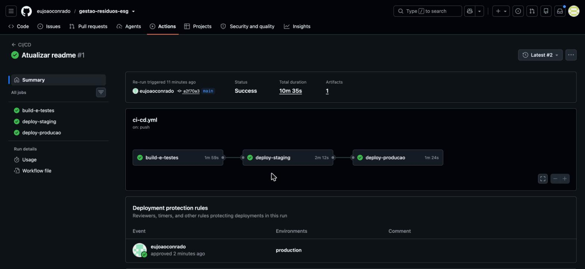
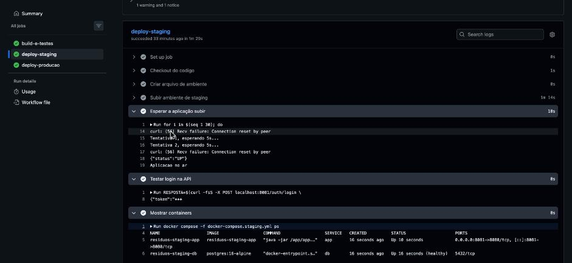
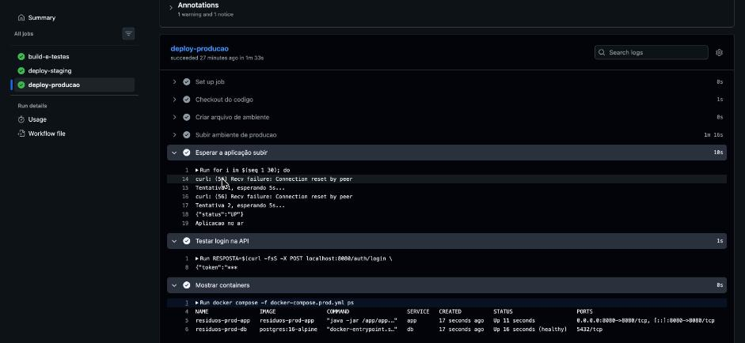
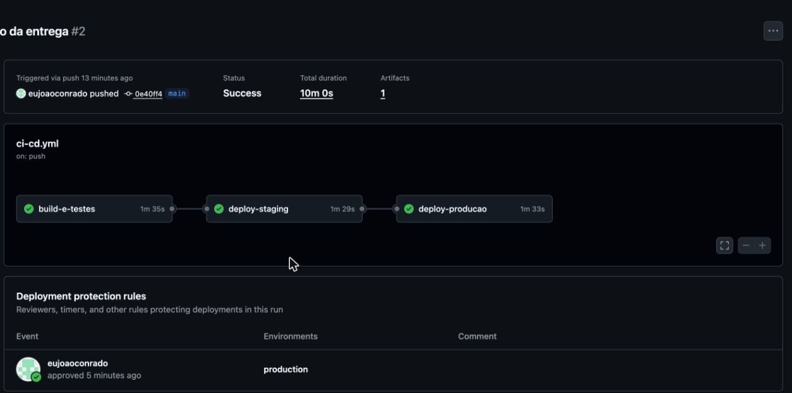
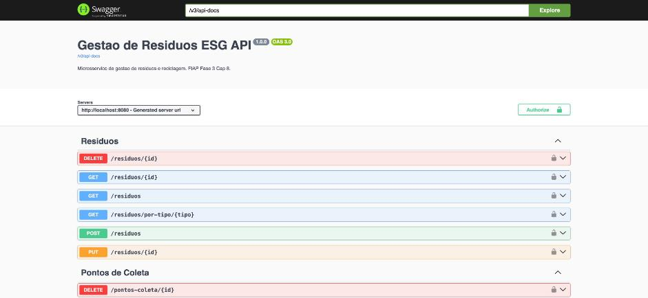

# Desafio DevOps - Gestão de Resíduos e Reciclagem (ESG)

**Integrante:** João Paulo Conrado Silva (RM 562593) - Grupo 92 - FIAP ADS 2TDSOA - Fase 6

**Repositório:** <https://github.com/eujoaoconrado/gestao-residuos-esg>

O projeto é a API de gestão de resíduos e reciclagem feita na Fase 3 (Spring Boot 3.2, Java 17, JWT, Flyway). Nesta fase ela foi colocada em containers e ganhou um pipeline de CI/CD com deploy em dois ambientes: staging e produção.

## 1. Descrição do pipeline

**Ferramenta:** GitHub Actions. O pipeline fica no arquivo `.github/workflows/ci-cd.yml`.

**Gatilhos:**

- `push` na branch `main`: roda o pipeline inteiro (build, testes, staging e produção).
- `pull_request` para a `main`: roda só o build e os testes, os deploys ficam de fora.

**Lógica:** são três jobs em sequência. Um job só começa se o anterior passou.

1. **build-e-testes** compila e testa o código.
2. **deploy-staging** sobe o ambiente de staging automaticamente.
3. **deploy-producao** sobe o ambiente de produção, mas só depois de uma aprovação manual. As senhas de produção vêm dos secrets do repositório.

Os ambientes de staging e produção sobem dentro do próprio runner do GitHub Actions com Docker Compose. Cada um tem a aplicação e um Postgres próprios.

Uma limitação que precisa ficar clara: os ambientes de staging e produção são efêmeros. Eles sobem no runner do GitHub Actions com Docker Compose, são testados (health check, login e um endpoint com token) e são derrubados no fim do job. Não existe servidor público nem URL para acessar depois. Cada ambiente constrói a imagem a partir do mesmo commit. Escolhi esse formato para não depender de servidor pago.

### Job 1: build-e-testes

Roda em `ubuntu-latest`. Passos:

1. **Checkout do codigo** (`actions/checkout@v4`).
2. **Configurar Java 17** (`actions/setup-java@v4`, distribuição temurin, com cache do Maven).
3. **Build e testes**: `mvn -B verify`. Compila o projeto e roda os 4 testes automatizados (JUnit 5 + MockMvc com banco H2 em memória): a aplicação sobe, o login do admin devolve token, um endpoint protegido sem token é bloqueado e o `/actuator/health` responde.
4. **Guardar o jar gerado**: `actions/upload-artifact@v4` com o `target/*.jar`.
5. **Build da imagem docker**: `docker build -t gestao-residuos-esg .`, para garantir que o Dockerfile funciona.

### Job 2: deploy-staging

Só roda em push na `main` (`if: github.ref == 'refs/heads/main'`), depois do job 1. Usa o environment `staging` do GitHub. Passos:

1. **Checkout do codigo**.
2. **Criar arquivo de ambiente**: `cp .env.staging.example .env.staging`.
3. **Subir ambiente de staging**: `docker compose -f docker-compose.staging.yml up -d --build`.
4. **Esperar a aplicação subir**: chama `curl -fsS localhost:8081/actuator/health` até 30 vezes, com 5 segundos de intervalo. Se não responder, o job falha.
5. **Testar login na API**: faz `POST /auth/login` com o usuário `admin@fiap.com` e confere com `grep` se a resposta tem o campo `token`.
6. **Testar endpoint com token**: faz o login de novo, pega o token da resposta e chama `GET /empresas` com `Authorization: Bearer`. Confere com `grep` se veio a empresa `EcoBrasil`, que é do seed do Flyway, para garantir que a API leu os dados do Postgres.
7. **Mostrar containers**: `docker compose -f docker-compose.staging.yml ps`.
8. **Logs da aplicação**: últimas 40 linhas do log do container da API.
9. **Derrubar ambiente**: `docker compose -f docker-compose.staging.yml down -v`. Tem `if: always()`, então roda mesmo se algum passo falhar.

### Job 3: deploy-producao

Roda depois do staging e usa o environment `production` do GitHub. Nesse environment foi configurada a regra *required reviewers*, então o job fica parado em "Waiting" até alguém aprovar no GitHub.

Os passos são os mesmos do staging, com o arquivo `docker-compose.prod.yml` e a porta 8080. A diferença está no arquivo de variáveis: em vez de copiar o exemplo, o job monta o `.env.prod` com `printf`, usando os secrets `PROD_DB_PASSWORD` e `PROD_JWT_SECRET` cadastrados no repositório. Assim a senha do banco e a chave do JWT de produção não ficam no código.

## 2. Docker

### Arquitetura

Cada ambiente tem dois containers: a API (Spring Boot) e o banco (PostgreSQL 16). Os dois ficam numa rede própria, o banco guarda os dados num volume próprio e as configurações vêm de um arquivo `.env` próprio. A API só sobe depois que o healthcheck do Postgres (`pg_isready`) fica saudável. Na subida o Flyway cria as tabelas e os dados de exemplo.

| Ambiente | Arquivo | Containers | Porta | Volume | Rede | Variáveis |
|----------|---------|------------|-------|--------|------|-----------|
| Local | `docker-compose.yml` | `gestao-residuos-db` / `gestao-residuos-app` | 8080 | `postgres_data` | `residuos-net` | `.env` |
| Staging | `docker-compose.staging.yml` | `residuos-staging-db` / `residuos-staging-app` | 8081 | `postgres_data_staging` | `residuos-staging-net` | `.env.staging` |
| Produção | `docker-compose.prod.yml` | `residuos-prod-db` / `residuos-prod-app` | 8080 | `postgres_data_prod` | `residuos-prod-net` | `.env.prod` (secrets) |

As variáveis usadas pela API são `DB_URL`, `DB_USER`, `DB_PASSWORD`, `JWT_SECRET` e `JWT_EXPIRATION`. Os arquivos `.env` de verdade estão no `.gitignore`; no repositório ficam só os `.example`.

### Comandos usados

```bash
# ambiente local
cp .env.example .env
docker compose up --build
docker compose down -v

# staging (o mesmo que o pipeline roda)
cp .env.staging.example .env.staging
docker compose -f docker-compose.staging.yml up -d --build
docker compose -f docker-compose.staging.yml ps
docker compose -f docker-compose.staging.yml down -v

# producao
docker compose -f docker-compose.prod.yml up -d --build
docker compose -f docker-compose.prod.yml down -v

# so a imagem da aplicacao
docker build -t gestao-residuos-esg .
```

### Imagem criada

A imagem da API é feita com um Dockerfile multi-stage. O primeiro estágio usa a imagem do Maven com JDK 17 para baixar as dependências e gerar o `.jar`. O segundo estágio usa só o JRE (`eclipse-temurin:17-jre-jammy`) e copia apenas o `.jar`, então a imagem final não leva o Maven nem o código fonte e fica menor.

```dockerfile
# ---------- Build stage ----------
FROM maven:3.9-eclipse-temurin-17 AS build
WORKDIR /app

COPY pom.xml .
RUN mvn dependency:go-offline -B

COPY src ./src
RUN mvn clean package -DskipTests -B

# ---------- Runtime stage ----------
FROM eclipse-temurin:17-jre-jammy
WORKDIR /app

COPY --from=build /app/target/*.jar app.jar

EXPOSE 8080

ENTRYPOINT ["java", "-jar", "/app/app.jar"]
```

## 3. Prints do pipeline rodando (build, testes, deploy)

Runs usados nos prints: #1 (primeira execução, <https://github.com/eujoaoconrado/gestao-residuos-esg/actions/runs/38469841023>) e #2 (<https://github.com/eujoaoconrado/gestao-residuos-esg/actions/runs/38474803117>)

{width=600px}

{width=600px}

{width=600px}

## 4. Prints dos ambientes staging e produção funcionando

{width=600px}

{width=600px}

{width=600px}

{width=600px}

Log exportado do job (trecho):

```text
{"status":"UP"}
Aplicacao no ar
$ RESPOSTA=$(curl -fsS -X POST localhost:8081/auth/login \
{"token":"***
$ docker compose -f docker-compose.staging.yml ps
NAME                   IMAGE                  COMMAND                  SERVICE   CREATED          STATUS                    PORTS
residuos-staging-app   residuos-staging-app   "java -jar /app/app.…"   app       16 seconds ago   Up 10 seconds             0.0.0.0:8081->8080/tcp,
residuos-staging-db    postgres:16-alpine     "docker-entrypoint.s…"   db        16 seconds ago   Up 16 seconds (healthy)   5432/tcp
```

## 5. Desafios encontrados e como foram resolvidos

**Secrets criados depois do pipeline começar.** No primeiro run, o build, os testes e o staging passaram, mas o deploy de produção falhou. Eu cadastrei os secrets `PROD_DB_PASSWORD` e `PROD_JWT_SECRET` poucos segundos depois do push. O GitHub montou o run antes de os secrets existirem, então o job de produção recebeu as variáveis vazias. O `.env.prod` ficou com a senha em branco e o Postgres não sobe sem senha. Para resolver, re-executei o job de produção já com os secrets cadastrados, aprovei de novo e o ambiente subiu. A lição foi cadastrar os secrets antes de fazer o push. Para não repetir o problema, o passo que monta o `.env.prod` poderia validar se a variável veio vazia e parar com uma mensagem clara.

**Troca do Oracle pelo PostgreSQL.** O projeto da Fase 3 usava Oracle XE. A imagem do Oracle XE tem uns 2 GB e demora para subir, o que não cabe bem no runner gratuito do GitHub, onde staging e produção sobem a cada deploy. Troquei para o PostgreSQL 16 (imagem alpine, bem menor): mudei o driver no `pom.xml`, o dialeto no `application.yml` e reescrevi as migrations do Flyway (`NUMBER` virou `BIGINT`/`NUMERIC`, `VARCHAR2` virou `VARCHAR` e `SYSTIMESTAMP` virou `CURRENT_TIMESTAMP`). O resto do código não precisou mudar.

**Lombok não compilava no JDK 25.** A minha máquina tem o JDK 25 como padrão e o Lombok 1.18.34 do projeto não funciona com ele, então o `mvn verify` falhava na compilação. Como o projeto é Java 17, fixei o `JAVA_HOME` no JDK 17 para rodar o Maven localmente. No pipeline e no Dockerfile isso não acontece, porque os dois já usam imagens com Java 17.

**Projeto sem testes.** O projeto original não tinha nenhum teste automatizado. Criei 4 testes de fumaça com banco H2 em memória (a aplicação sobe, login do admin, endpoint protegido sem token e health check). Como os testes usam H2, as migrations do Postgres só são exercitadas no smoke test de staging e produção.

## 6. Checklist de entrega

| Item | Status |
|------|--------|
| Projeto compactado em .ZIP com estrutura organizada | OK |
| Dockerfile funcional | OK |
| docker-compose.yml ou arquivos Kubernetes | OK |
| Pipeline com etapas de build, teste e deploy | OK |
| README.md com instruções e prints | OK |
| Documentação técnica com evidências (PDF ou PPT) | OK |
| Deploy realizado nos ambientes staging e produção | OK |
